# html-slide

A slide template for research talks that runs in a web page: PowerPoint-style animated builds, Beamer-quality math, and a
speaker script, plus **comments that coauthors and AI agents (e.g., Claude Code and Codex) can act on**. The example is the
29-slide **Pricing AI as a Service** INFORMS talk, including its 16-minute script and 77 build states.

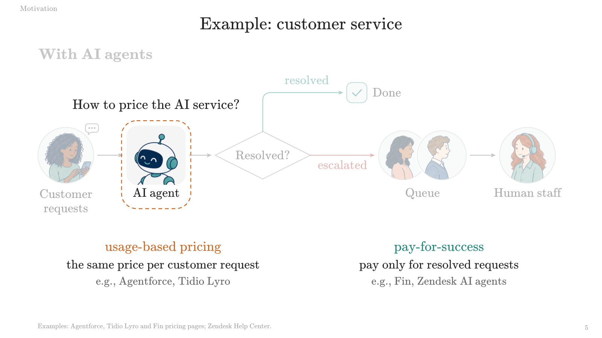

## Contents

1. [Highlights](#highlights)
2. [Quick start](#quick-start)
3. [Key feature: comments](#key-feature-comments)
4. [Features in detail](#features-in-detail)
5. [Make your own talk](#make-your-own-talk)
6. [Share it online (optional Cloudflare)](#share-it-online-optional-cloudflare)
7. [Local review with an inbox](#local-review-with-an-inbox)
8. [Where things live](#where-things-live)
9. [License](#license)

## Highlights

- **Animated builds.** A slide reveals one idea per click. The example talk has 77 build states across 29 slides.
- **Beamer-quality math.** LaTeX formulas are typeset by the bundled MathJax.
- **Works offline.** The deck runs on your computer. The images, fonts, and math renderer are included, and
  `npm run bundle` packs everything into one HTML file.
- **Speaker script.** Press `s` twice for a script panel that follows each click. All notes are also collected in one
  editable file, [SCRIPT.md](SCRIPT.md).
- **Comments your AI agent can act on.** Coauthors comment on the exact slide and click, mark a box, and attach
  screenshots. Their feedback comes back to you tagged with that slide and click, so you, or an AI agent (e.g., Claude Code
  or Codex), can fix it, republish, and reply.
- **One link and a passcode.** Put the deck online with the optional Cloudflare site, and anyone you give the link and
  passcode can comment on any slide and edit the script in their browser: no accounts, nothing to install.
- **Print, bundle, and check.** Print each slide or every build, make a single HTML file, and capture every build as PNGs.
- **Controls made for presenting.** Single keys, a menu that opens only on purpose, and no script button for a stray click
  to hit.

## Quick start

### Open the deck

1. Clone or download this repository.
2. Open [deck/index.html](deck/index.html) in your browser.

The images, fonts, and math renderer are included, so you can present offline.

If you prefer a local web address, run this from the repository folder:

```sh
python3 -m http.server 8000 --bind 127.0.0.1 --directory deck
```

Then open [http://127.0.0.1:8000](http://127.0.0.1:8000). This is a slide preview; the shared comment service is set up in
[Share it online](#share-it-online-optional-cloudflare).

### Present

Presenting needs only a few keys: **`s`** slides, **`s` `s`** script, **`c`** comment, **`f`** full screen. The menu
(**Slides**, **Full screen**, **Comment**) opens with **`m`** or the small dot in the bottom-right corner, which fades in
when the pointer comes near.

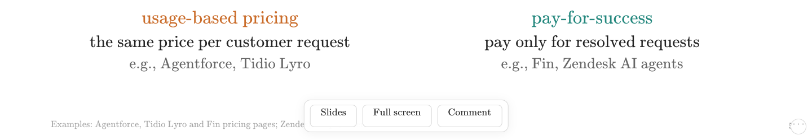

| Action | Mouse or key |
| --- | --- |
| Next build, then next slide | Click the slide, `→`, `↓`, Space, Enter, Page Down, or `n` |
| Previous build | Right-click, `←`, `↑`, Page Up, Backspace, or `p` |
| Skip to the next or previous slide | Shift + an arrow key |
| Slide overview | `s` (or `g`, or **Slides** in the menu); select a thumbnail |
| Speaker script | `s` `s`: press `s` twice quickly (again to close) |
| Comment on this slide and click | `c` (or **Comment** in the menu) |
| Full screen | `f` (or **Full screen** in the menu) |
| Menu | `m`, or the dot in the bottom-right corner |
| Blank the screen | `b` |
| First or last slide | Home or End |
| Jump to a slide number | Type the number, then Enter |
| Close overview, comments, menu, or blank screen; cancel a jump | Escape |

The address records the current slide and build, such as `#5.2` for slide 5, click 2. Visible source links on slides open
their sources.

### Why these controls

In a talk, nothing should appear unless you ask for it.

- The menu does not slide up when the pointer touches the bottom edge, which happens by accident while presenting. It opens
  only on purpose (`m` or the corner dot) and closes once you use it.
- The actions you need most are single keys you can press without looking at the screen.
- The script has no button, so a stray click never shows your notes to the audience; `s` `s` opens it.
- The pointer hides after two seconds without moving, so it never sits on a slide.

The controls live in `deck/js/presenter.js` and `deck/css/presenter.css`. To go back to the engine's own bottom bar, which
slides up when the pointer reaches the bottom edge and has a **Script** button, remove the two lines that load them from
`deck/index.html`.

## Key feature: comments

Coauthors leave feedback on the exact slide and click. It reaches your computer with everything needed to fix that slide,
and your reply appears under the original comment. Comments run on the optional Cloudflare site, online or as a local
preview ([Share it online](#share-it-online-optional-cloudflare)).

### For coauthors

**One link.** Send the site's link and passcode. Everyone with the link and passcode has the same viewing and editing
access.

Each coauthor then:

1. **Open the link** and enter the passcode. The shared site asks for it before displaying the deck or its feedback.
2. On any slide, press `c` (or **Comment** in the menu). This opens feedback for the current slide and click.
3. **Type** the comment.
4. Optionally, **draw a box** around the part you mean (**Mark on slide**). Stay on that build when sending a marked box.
5. Optionally, **paste or drop** up to four screenshots.
6. **Send.**

To suggest new wording instead, press `s` twice to open the script and rewrite a note
([Script edits from the browser](#script-edits-from-the-browser)).

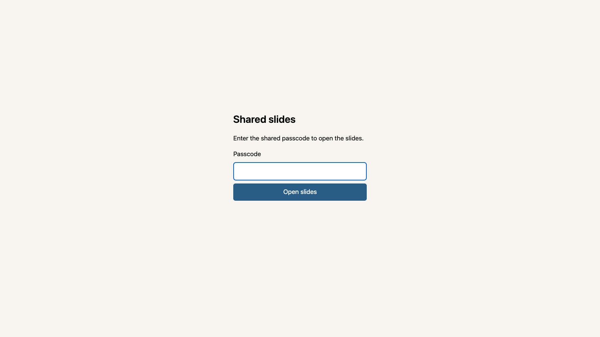

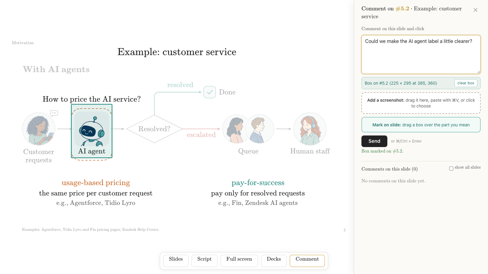

**A comment goes through three steps:**

| **1. Write, mark, attach** | **2. Sent** | **3. Fixed and answered** |
| --- | --- | --- |
| 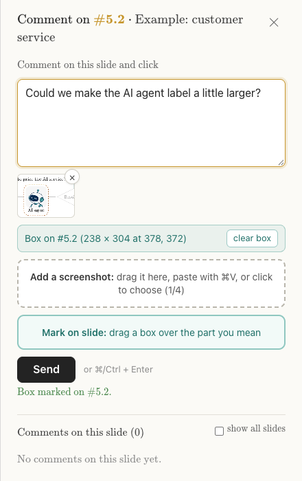 | 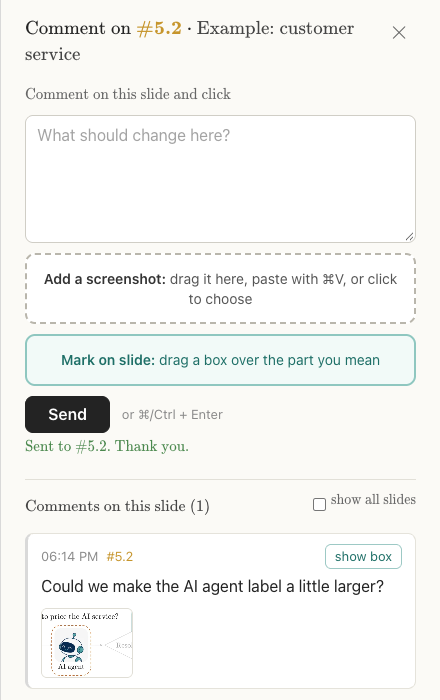 | 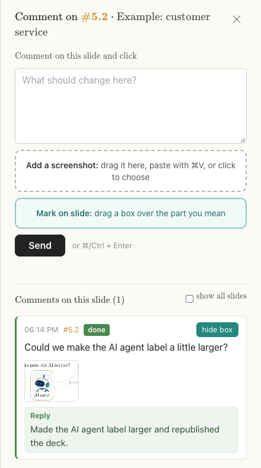 |

The author fixes the slide, republishes, and replies with `resolve.mjs`; the reply stays under the original comment. Tick
**show all slides** to see the feedback across the talk. The screenshots use a local preview and sample feedback.

### What a comment contains

`cloudflare/comments/watch.mjs` brings new comments to your computer. Each comment comes with:

- its slide ID and click number;
- the comment text;
- the marked box (with `--render-box`, also a slide PNG with that box drawn on it);
- the attached images, saved under `work/cloudflare/`.

The comment in the picture above reaches your computer like this:

```text
=== COMMENT (template) === #5.2 (M08) Example: customer service
by (unnamed) | 2026-11-04T18:14:18.325Z | open
Could we make the AI agent label a little larger?
box: x=378 y=372 w=238 h=304 (1920x1080 slide coordinates)
reference: open deck/index.html; slide 5 (M08), click 2
cid: 0mw2frkyd-f205d40b
image 0: image/webp 380x300 10.3 KB
saved: work/cloudflare/local-5c02014bd8b5/attachments/0mw2frkyd-f205d40b_0.webp
```

`#5.2` is slide 5, click 2, and `cid` is the comment ID that `resolve.mjs` takes when you reply.

### For your AI agent

With precise, local feedback, an AI agent (e.g., Claude Code or Codex) can work through each comment:

1. Read the comment that `watch.mjs` printed.
2. Edit the slide's file in [deck/slides/](deck/slides/).
3. Check it with `npm run shots`.
4. Publish.
5. Answer with `cloudflare/comments/resolve.mjs`. The reply appears under the original comment on the site.

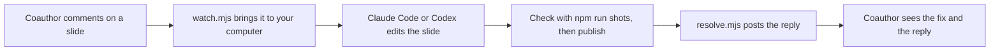

Before you hook one up:

- Set up the shared site first: [Try it on your computer](#try-it-on-your-computer), then
  [Deploy to your own Cloudflare account](#deploy-to-your-own-cloudflare-account).
- Give the agent permission to edit files and run commands in this folder, in its own settings.
- **Check its work before it publishes**, at least at first: the reply goes straight to your coauthors.

### Hook it up to Claude Code

1. Start Claude Code in the repository folder.
2. Give it a standing instruction like this:

   > Run `node cloudflare/comments/watch.mjs --remote --config cloudflare/wrangler.user.toml` in the background. It waits for new
   > comments and exits when they arrive. For each comment: fix that slide in `deck/slides/`, check every click with
   > `npm run shots -- --ids SLIDE_ID`, publish with `CF_PROJECT_NAME=your-pages-project CF_CONFIG=cloudflare/wrangler.user.toml
   > bash cloudflare/publish.sh deploy`, then reply with `node cloudflare/comments/resolve.mjs COMMENT_ID "what you changed"
   > --remote --config cloudflare/wrangler.user.toml`. Then start the watcher again.

Claude Code is notified when the background watcher finishes, so each new comment starts the next round.

Without a session, you can pipe one batch to it instead:

```sh
node cloudflare/comments/watch.mjs --remote --config cloudflare/wrangler.user.toml | \
  claude -p "Fix the slides these comments ask for in deck/slides/, check them with npm run shots, publish, and reply to each comment with cloudflare/comments/resolve.mjs."
```

### Hook it up to Codex

`codex exec` reads piped input after its prompt, so the same one-batch loop works:

```sh
node cloudflare/comments/watch.mjs --remote --config cloudflare/wrangler.user.toml | \
  codex exec "Fix the slides these comments ask for in deck/slides/, check them with npm run shots, publish, and reply to each comment with cloudflare/comments/resolve.mjs."
```

Run it again, or in a loop, for the next batch.

### Script edits from the browser

Coauthors' script edits come back the same way as comments. `script_watch.mjs` lists them, and `apply_note.mjs` writes them into
the slide files and [SCRIPT.md](SCRIPT.md), so the next publish gives everyone the new wording. The commands are in
[Bring shared script edits into the source](#bring-shared-script-edits-into-the-source), and the editing itself is described
in [Edits made in the browser](#edits-made-in-the-browser).

### Keep feedback on your own computer

Prefer to keep feedback local? Write comments into [inbox/INBOX.md](inbox/INBOX.md) instead. Its watcher hands each finished
comment to any agent command, for example `--command claude -p` or `--command codex exec`
([Local review with an inbox](#local-review-with-an-inbox)).

## Features in detail

### Slide overview

The overview (`s`) shows every slide with its number and title; select one to jump there.

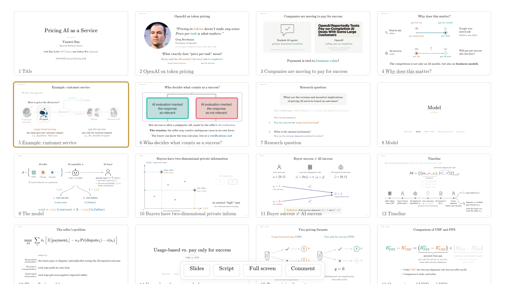

### Animated builds

A slide can reveal one idea at a time. These are three real states of the same slide:

| On entry | First click | Second click |
| --- | --- | --- |
| 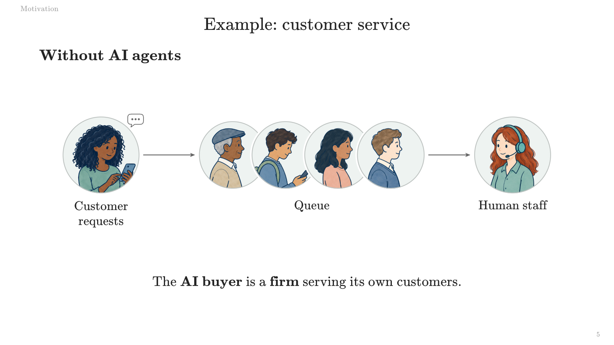 | 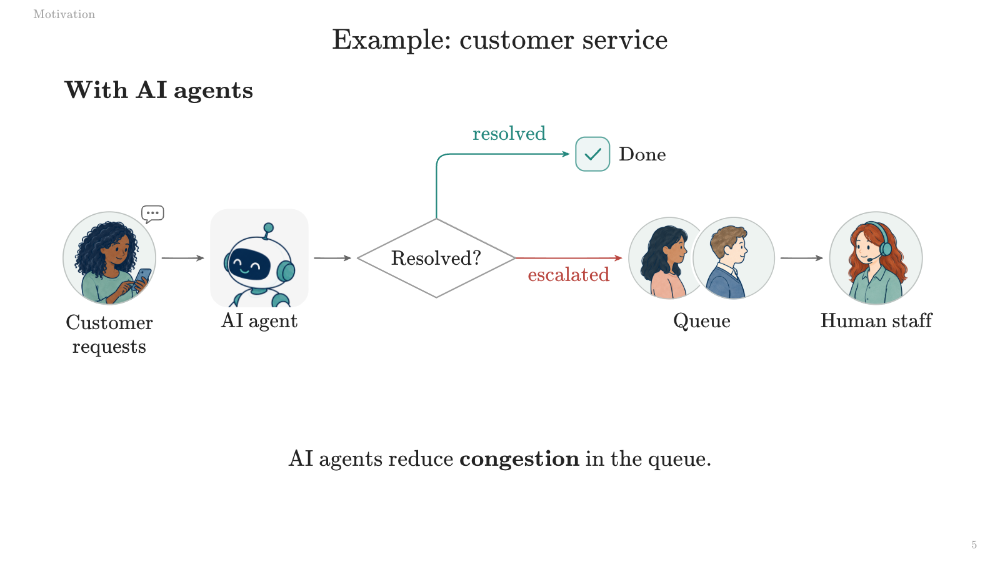 |  |

### Speaker script

The script panel (`s` `s`) follows the current click, highlights its note, and shows the next slide's title. Click a note to
edit it ([Edits made in the browser](#edits-made-in-the-browser)).

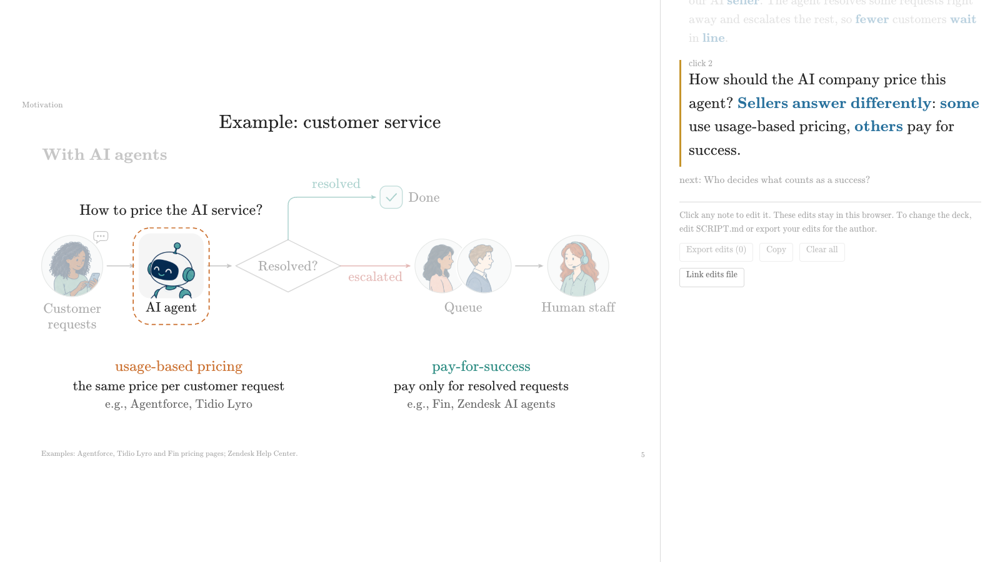

### Math

Slides write math in LaTeX: `\(` and `\)` around inline math, `\[` and `\]` around display math. Inside a slide file's
JavaScript strings, each backslash is doubled, as in `\\(\\Longrightarrow\\)`. The bundled MathJax in
[deck/vendor/mathjax/](deck/vendor/mathjax/) typesets it, also offline; its settings are at the top of
[deck/index.html](deck/index.html).

## Make your own talk

The usual loop:

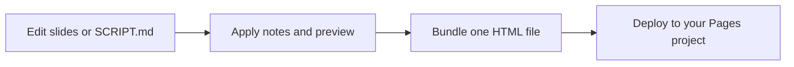

### Set up the helper commands

For the helper commands below, install [Node.js](https://nodejs.org/) 22 or newer, then run:

```sh
npm install
```

| Command | What it does |
| --- | --- |
| `npm run script:apply` | Write the notes in SCRIPT.md into the slide files |
| `npm run script:watch` | Apply SCRIPT.md each time you save it |
| `npm run script:export` | Rebuild SCRIPT.md from the slide files |
| `npm run bundle` | Build one offline HTML file, `dist/deck.html` |
| `npm run shots` | Capture every slide and build as PNGs |
| `npm run cf:stage` | Build the shared site into `cloudflare/site/` without uploading |
| `npm run cf:dev` | Stage the shared site, then serve it locally with Wrangler |

### Edit slides

Each slide has one JavaScript file in [deck/slides/](deck/slides/). [order.js](deck/slides/order.js) lists the filenames in
presentation order. A slide declares its ID, number of click steps, content, and notes. You or a coding agent can edit these
files, reload the browser, and check the result.

The slide files are the INFORMS version of the talk. To make another version, copy `deck/`, edit that copy, and give its
path to the tools with `--deck`.

### Edit the script

[SCRIPT.md](SCRIPT.md) collects the spoken notes in one editable file. Click 0 is the note when a slide first appears.

1. Edit the text between each pair of `slide-note` markers. Keep the headings and marker lines. Use `<b>words</b>` for a
   bold speaking cue.
2. Apply it:

   ```sh
   npm run script:apply
   ```

3. Reload the deck to see the changes.

For repeated editing, leave this running in a terminal:

```sh
npm run script:watch
```

Good to know:

- **Conflicts.** The marker's base hash lets the tool detect a note that changed elsewhere; a conflict leaves the batch
  untouched so you can review it.
- **Dry run.** To check without writing, run `npm run script:apply -- --dry-run`.
- **Editing notes in slide files.** If you edit notes directly in slide files, save any pending SCRIPT changes before
  rebuilding SCRIPT.md:

  ```sh
  npm run script:export -- --force
  ```

### Edits made in the browser

Click any note in the script panel. Click outside or press Command (or Control) + Enter to finish; Escape restores the
previous edit. Edits are also saved as you type.

Where the edits go depends on where the deck runs:

| Where the deck runs | What happens to browser edits |
| --- | --- |
| An ordinary local or offline deck | They stay in that browser. **Export edits** downloads the changed notes, and **Copy** copies them. In a supporting browser, **Link edits file** keeps a file such as `SCRIPT_EDITS.md` updated. |
| The Cloudflare site | They are also sent to the author after a short pause. A saved message confirms receipt. The author reviews and applies them locally, then republishes the deck so everyone receives the updated script. |

**Adopting a browser export.** Those browser exports are a review handoff with old and new text. To adopt one, put its new
wording into the matching blocks in SCRIPT.md and run `script:apply`. Keep the `slide-note` markers in SCRIPT.md; an
exported `SCRIPT_EDITS.md` is a different format.

**Two coauthors, one note.** On the Cloudflare site, if another coauthor saved the same note, a comparison keeps both
versions. Review them before choosing **Use shared version** or **Save my version**.

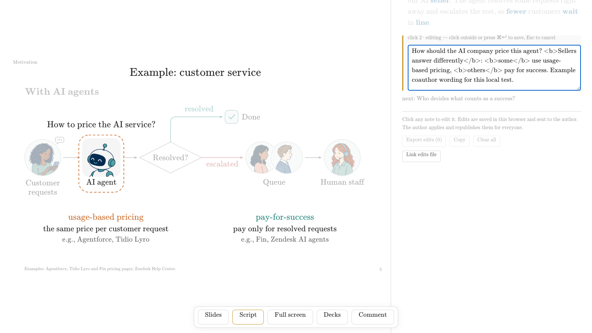

### Bundle, print, and check

**One HTML file.** Make a single HTML file you can send or present offline:

```sh
npm run bundle
```

Open `dist/deck.html`. It includes the slides, images, fonts, math renderer, and presentation controls. Live collaboration is
enabled by the Cloudflare site; the offline file explains this when you open Comment.

**Print.** Open the local preview with [\?print](http://127.0.0.1:8000/?print) to print each slide's final state. Use
[\?print=steps](http://127.0.0.1:8000/?print=steps) to print every build, then use the browser's Print command.

**Capture every slide and build** with an installed Chrome or Chromium:

```sh
npm run shots -- --out .local/shots
```

- The output includes PNGs and `manifest.json`, with slide IDs, click numbers, and any browser errors.
- A focused check can use `npm run shots -- --ids U02 --click 1`.
- Set `CHROME_PATH` or pass `--chrome` if the tool cannot find your browser. The tool does not download a browser.

## Share it online (optional Cloudflare)

Cloudflare Pages serves the deck, and its D1 database stores comments and script suggestions. You can try both locally
before creating an online project.

1. [Try it on your computer](#try-it-on-your-computer)
2. [Deploy to your own Cloudflare account](#deploy-to-your-own-cloudflare-account)
3. [Pull comments, fix, and reply](#pull-comments-fix-and-reply)
4. [Bring shared script edits into the source](#bring-shared-script-edits-into-the-source)

These steps need the helper commands ([Set up the helper commands](#set-up-the-helper-commands)). For more detail, see
[cloudflare/USAGE.md](cloudflare/USAGE.md).

### Try it on your computer

1. Create your own ignored `cloudflare/.dev.vars` file in a text editor:

   ```dotenv
   PASSCODE="choose-your-own-passcode"
   COOKIE_SECRET="replace-with-a-long-random-secret"
   ```

   Use your own values. A cookie secret can be generated with `openssl rand -hex 32`. Keep this file private and out of Git.

2. From the repository folder, initialize the local database and start the site:

   ```sh
   npx wrangler d1 execute html-slide-comments --local \
     --config cloudflare/wrangler.toml \
     --persist-to cloudflare/.wrangler/state \
     --file cloudflare/comments/schema.sql
   npm run cf:dev
   ```

3. Open the address printed by Wrangler, normally [http://127.0.0.1:8788](http://127.0.0.1:8788), and enter your chosen
   passcode.
4. Try sending a comment with a box, editing a script note, and using the author commands in
   [Pull comments, fix, and reply](#pull-comments-fix-and-reply).

Notes:

- Pages development runs locally; it takes no `--local` flag. D1 commands use `--local` to select the local database.
- Keep the same persistence directory when restarting.
- On this site the menu also has **Decks**, which opens the one-deck list.

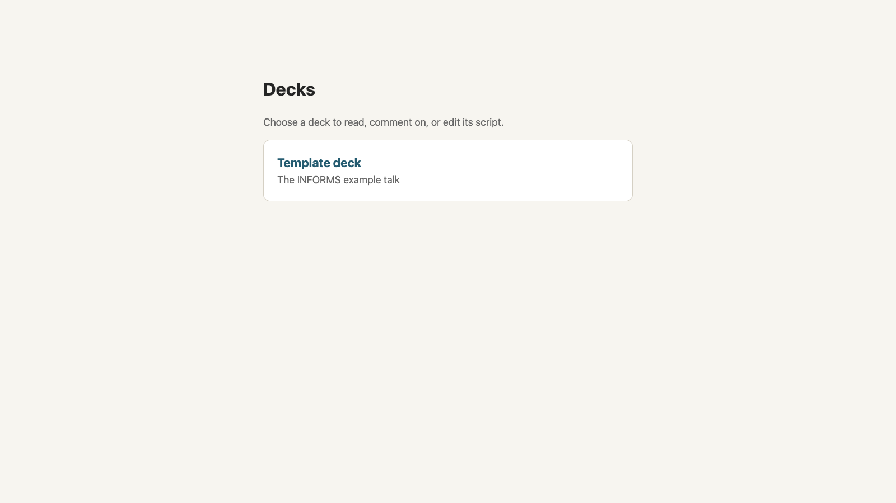

### Deploy to your own Cloudflare account

Create a Cloudflare account, then run these commands from the repository folder. The
[official Pages guide](https://developers.cloudflare.com/pages/get-started/direct-upload/) explains the upload setup, and the
[Pages bindings guide](https://developers.cloudflare.com/pages/functions/bindings/) covers D1 and secrets.

1. Sign in and create your Pages project. Choose your own project name in place of `your-pages-project`.

   ```sh
   npx wrangler login
   npx wrangler pages project create your-pages-project --production-branch main
   ```

2. Copy the generic config into the ignored file for your own settings, and create a database.

   ```sh
   cp cloudflare/wrangler.toml cloudflare/wrangler.user.toml
   npx wrangler d1 create html-slide-comments --config cloudflare/wrangler.user.toml
   ```

   In `cloudflare/wrangler.user.toml`:

   - Set `name` to your Pages project name.
   - Under `[[d1_databases]]`, add `database_id` using the ID that Wrangler just printed.
   - Keep `binding = "COMMENTS_DB"`.

   The committed config omits a database ID so it can be used for local development. If you choose another database name,
   update `database_name` and use that name in commands too.

3. Create the tables in your online database. This command explicitly selects the remote database.

   ```sh
   npx wrangler d1 execute html-slide-comments --remote \
     --config cloudflare/wrangler.user.toml \
     --file cloudflare/comments/schema.sql
   ```

4. Set the two Pages secrets. Each command prompts for a value; enter your own shared passcode and a long random cookie
   secret.

   ```sh
   npx wrangler pages secret put PASSCODE --project-name your-pages-project
   npx wrangler pages secret put COOKIE_SECRET --project-name your-pages-project
   ```

   These are Pages secrets. Keep their values out of the config and repository. If you change them later, deploy again;
   existing sign-ins will expire.

5. Build and publish the deck to that project.

   ```sh
   CF_PROJECT_NAME=your-pages-project \
   CF_CONFIG=cloudflare/wrangler.user.toml \
   bash cloudflare/publish.sh deploy
   ```

   The script uses branch `main` by default. If your login has several accounts, set `CLOUDFLARE_ACCOUNT_ID` in your own
   environment to select the intended account. The project name comes from `CF_PROJECT_NAME`; the database comes from your
   config.

6. Share the Pages link and your chosen passcode with coauthors. Ask them to open a slide, press `c` (or **Comment** in the
   menu), optionally mark a box or attach an image, and send. To suggest wording changes, they press `s` twice to open the
   script; the saved message confirms the server received them.

For a local build without uploading, run `npm run cf:stage`. It writes `cloudflare/site/`; the Pages Functions stay in the
sibling `cloudflare/functions/` folder. The publish script's default action is staging. Uploading requires its explicit
`deploy` argument.

### Pull comments, fix, and reply

Which database the author tools use (in this section and the next):

- **Local by default.** The author tools use local D1 by default. For local experiments, leave off `--remote` and the user
  config.
- **Your shared site.** Add `--remote --config cloudflare/wrangler.user.toml` to each command. There is no automatic switch
  to the online database.
- **Another database name.** If you change the database name, use `--database YOUR_DATABASE_NAME`.

Then:

1. List comments from the shared site, including resolved comments and their replies:

   ```sh
   node cloudflare/comments/watch.mjs --list \
     --remote --config cloudflare/wrangler.user.toml
   ```

   | Option | What it does |
   | --- | --- |
   | `--list` | List all comments, including resolved comments and their replies |
   | `--once` | A single scan of new open feedback |
   | Neither `--list` nor `--once` | Wait for the next batch and exit when it arrives |
   | `--render-box` | Also save a slide PNG with the marked rectangle, using the installed screenshot browser |

   The output identifies the slide and click, includes any marked box, and saves attached images under ignored
   `work/cloudflare/`.

2. Fix the slide, check it, and republish it.
3. Reply to its comment ID:

   ```sh
   node cloudflare/comments/resolve.mjs COMMENT_ID \
     "Updated the figure and republished the deck." \
     --remote --config cloudflare/wrangler.user.toml
   ```

   The resolver archives the original and attachments before marking the comment done. Its reply appears beneath that
   comment on the site. Images remain available unless you explicitly request `--delete-images` after archiving.

### Bring shared script edits into the source

Review the suggested notes, check the proposed batch, then apply it:

1. List the suggested notes:

   ```sh
   node cloudflare/comments/script_watch.mjs --list \
     --remote --config cloudflare/wrangler.user.toml
   ```

2. Check the proposed batch without writing:

   ```sh
   node cloudflare/comments/apply_note.mjs --dry-run \
     --remote --config cloudflare/wrangler.user.toml
   ```

3. Apply it:

   ```sh
   node cloudflare/comments/apply_note.mjs \
     --remote --config cloudflare/wrangler.user.toml
   ```

4. Reload and check the local deck, then run the same publish command again
   ([step 5 of the deploy](#deploy-to-your-own-cloudflare-account)).

How it behaves:

- The script watcher normally waits for 20 seconds of quiet after an edit.
- The apply tool compares each suggestion with its original note, updates the slide files, and refreshes unchanged blocks in
  SCRIPT.md while keeping pending local script edits.
- Conflicting source notes leave the batch untouched. Review those differences before retrying.
- Applying notes locally does not republish the site. After publication, the coauthor's panel can show the updated source
  note in place of an already-applied browser suggestion.

See [cloudflare/USAGE.md](cloudflare/USAGE.md) and each tool's `--help` for configuration, quiet-time, and single-edit
options.

## Local review with an inbox

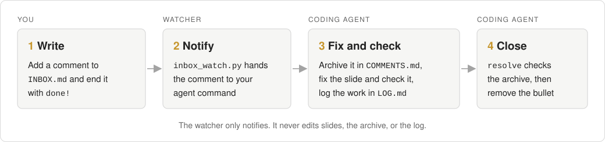

[inbox/INBOX.md](inbox/INBOX.md) is a place to write feedback while reviewing the deck. A watcher hands each finished comment
to your AI agent. No shared site is needed.

### Write a comment

1. Add one top-level bullet below the separator in INBOX.md.
2. Include the slide ID or number.
3. Put related details or screenshot links in indented lines.
4. End the complete comment with `done!` when it is ready for the coding agent to read.

```markdown
- U01: Please make the difference between these prices easier to see.
  The second click is the part I mean. done!
```

Here, `done!` means you have finished writing. The requested edit may still be unfinished. Draft bullets without that
ending stay out of the notification queue.

### Run the watcher

With Python 3 installed, run the watcher from the repository folder:

```sh
python3 inbox/inbox_watch.py \
  --inbox inbox/INBOX.md \
  --prompt-file inbox/on_change_prompt.txt \
  --state-dir .local/inbox
```

It prints a notification when a submitted comment appears.

- **Connect a coding agent.** Put its notifier command after `--command`, as the final option. The prompt and comment arrive
  on standard input.
- **Check the wiring.** Add `--command tee .local/inbox/notification.txt`; replace `tee` with your own agent's input command
  when ready.
- **One batch, then resume.** For an agent that waits for one batch and then resumes, use:

  ```sh
  python3 inbox/claude_inbox_watch.py \
    --inbox inbox/INBOX.md --state-dir .local/inbox
  ```

### Review convention

1. Archive the exact original comment in [inbox/COMMENTS.md](inbox/COMMENTS.md) before working on it. Keep earlier versions
   if the comment changes.
2. Record the interpretation, work, checks, and resolution in [inbox/LOG.md](inbox/LOG.md).
3. Keep the item in INBOX.md until every part is fixed and checked. Then remove it; keep its original and resolution in the
   archive and log.

The watchers notify; they do not edit slides or manage the archive for you. Their state stays in ignored `.local/inbox/`.

### Acknowledge, resolve, or reopen

- **Acknowledge a read:**

  ```sh
  python3 inbox/inbox_watch.py read --inbox inbox/INBOX.md --state-dir .local/inbox
  ```

- **Record a verified completion.** Copy only the completed original bullets, including `done!`, into
  `.local/inbox/resolved.md` below a `---` separator, then run:

  ```sh
  python3 inbox/inbox_watch.py resolve \
    --comments-file .local/inbox/resolved.md \
    --archive inbox/COMMENTS.md --state-dir .local/inbox \
    --note "Checked the requested changes; details are in inbox/LOG.md."
  ```

  This checks that the exact originals are archived and records completion in the watcher's state. Remove the completed
  inbox items after that check.

- **Reopen.** Use `reopen` with the same comments file and state directory if an item needs more work.

## Where things live

| File or folder | Purpose |
| --- | --- |
| `deck/` | The standalone example deck, slide files, engine, styles, and assets |
| `deck/index.html` | The page that loads MathJax, the engine, the slides, comments, and presenter controls |
| `deck/slides/` | One JavaScript file per slide; `order.js` sets the presentation order |
| `deck/js/` | The engine (`engine.js`), figure helpers (`lib.js`), comments (`comments.js`), and presenter controls (`presenter.js`) |
| `deck/css/` | Deck, comment, and presenter styles |
| `deck/assets/`, `deck/fonts/`, `deck/vendor/mathjax/` | Images, fonts, and the bundled math renderer |
| `SCRIPT.md` | The complete editable speaking script |
| `tools/` | Apply/watch notes, bundle HTML, and capture builds |
| `inbox/` | Local feedback template, notification watchers, archive, and work log |
| `cloudflare/` | The optional shared site, database schema, and author tools |
| `cloudflare/comments/` | Author tools (`watch.mjs`, `resolve.mjs`, `script_watch.mjs`, `apply_note.mjs`) and the database schema |
| `cloudflare/functions/` | The Pages Functions: passcode gate, comments, script edits, and the deck list |
| `docs/img/` | Real browser screenshots and the inbox diagram used in this guide |
| `dist/`, `.local/`, `work/` | Generated and ignored by Git: the bundle, shots and inbox state, and comment downloads, logs, and archives |

## License

The original template code is free to use, modify, and share. The example talk's content, photos, logos, and company
screenshots belong to their respective owners and are included as examples. Third-party code and fonts retain their own
licenses; see [LICENSE](LICENSE) and the included [MathJax license](deck/vendor/mathjax/LICENSE).
