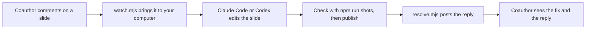
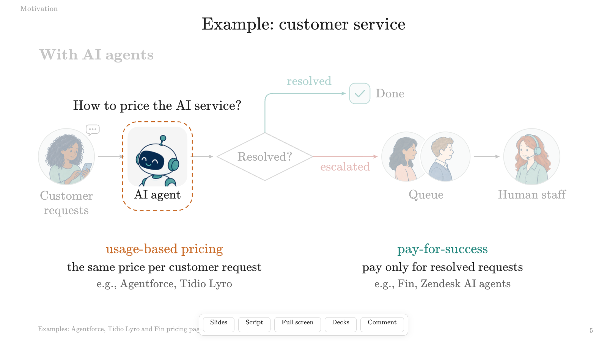
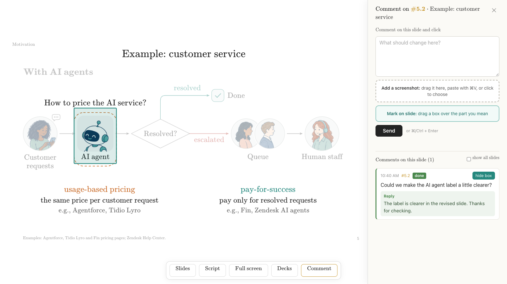
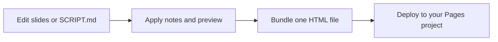

# html-slide

A slide template for research talks, with animated builds, a speaker script, and **comments that an AI coding agent can act
on**. The example is the 29-slide **Pricing AI as a Service** INFORMS talk, including its 16-minute script and 77 build states.

The deck runs on your computer. Put it online with the optional Cloudflare site, and **anyone you give the link and passcode can
comment on any slide and edit the script in their browser**: no accounts, nothing to install. Their feedback comes back to you
tagged with the exact slide and click, so you, or an agent such as Claude Code or Codex, can fix it, republish, and reply.


## Comments your AI agent can act on

**For coauthors: one link.** Send the site's link and passcode. On any slide they press **Comment**, type, draw a box around the
part they mean (**Mark on slide**), and paste or drop up to four screenshots. Or they open **Script** and rewrite a note. Everyone
with the link and passcode has the same access.


**For your agent: precise, local feedback.** `cloudflare/comments/watch.mjs` brings new comments to your computer. Each comment
comes with its slide ID, click number, text, the marked box (with `--render-box`, a slide PNG with that box drawn on it), and the
attached images, saved under `work/cloudflare/`. A coding agent can read that, edit the slide's file in
[deck/slides/](deck/slides/), check it with `npm run shots`, publish, and answer with
`cloudflare/comments/resolve.mjs`. The reply appears under the original comment on the site.



Script edits from the browser come back the same way. `script_watch.mjs` lists them, and `apply_note.mjs` writes them into the
slide files and [SCRIPT.md](SCRIPT.md), so the next publish gives everyone the new wording.

### Hook it up to Claude Code

Start Claude Code in the repository folder and give it a standing instruction like this:

> Run `node cloudflare/comments/watch.mjs --remote --config cloudflare/wrangler.user.toml` in the background. It waits for new
> comments and exits when they arrive. For each comment: fix that slide in `deck/slides/`, check every click with
> `npm run shots -- --ids SLIDE_ID`, publish with `CF_PROJECT_NAME=your-pages-project CF_CONFIG=cloudflare/wrangler.user.toml
> bash cloudflare/publish.sh deploy`, then reply with `node cloudflare/comments/resolve.mjs COMMENT_ID "what you changed"
> --remote --config cloudflare/wrangler.user.toml`. Then start the watcher again.

Claude Code is notified when the background watcher finishes, so each new comment starts the next round. Without a session, you
can pipe one batch to it instead:

```sh
node cloudflare/comments/watch.mjs --remote --config cloudflare/wrangler.user.toml | \
  claude -p "Fix the slides these comments ask for in deck/slides/, check them with npm run shots, publish, and reply to each comment with cloudflare/comments/resolve.mjs."
```

### Hook it up to Codex

`codex exec` reads piped input after its prompt, so the same one-batch loop works:

```sh
node cloudflare/comments/watch.mjs --remote --config cloudflare/wrangler.user.toml | \
  codex exec "Fix the slides these comments ask for in deck/slides/, check them with npm run shots, publish, and reply to each comment with cloudflare/comments/resolve.mjs."
```

Run it again, or in a loop, for the next batch. Give either agent permission to edit files and run commands in this folder, in its
own settings. **Check its work before it publishes**, at least at first: the reply goes straight to your coauthors.

Prefer to keep feedback on your own computer? Write comments into [inbox/INBOX.md](inbox/INBOX.md) instead. Its watcher hands
each finished comment to any agent command, for example `--command claude -p` or `--command codex exec`
([Review locally with an inbox](#review-locally-with-an-inbox)). To set up the shared site, see
[Try the shared features on your computer](#try-the-shared-features-on-your-computer) and
[Put it on your own Cloudflare account](#put-it-on-your-own-cloudflare-account).

## Open the talk

Open [deck/index.html](deck/index.html) in your browser. The images, fonts, and math renderer are included, so you can present offline.

If you prefer a local web address, run this from the repository folder:

```sh
python3 -m http.server 8000 --bind 127.0.0.1 --directory deck
```

Then open [http://127.0.0.1:8000](http://127.0.0.1:8000). This is a slide preview; the shared comment service is set up below.

Move the pointer near the bottom to find **Slides**, **Script**, **Full screen**, and **Comment**.

| Action | Mouse or key |
| --- | --- |
| Next build, then next slide | Click the slide, `→`, `↓`, Space, Enter, Page Down, or `n` |
| Previous build | Right-click, `←`, `↑`, Page Up, Backspace, or `p` |
| Skip to the next or previous slide | Shift + an arrow key |
| Slide overview | **Slides** or `g`; select a thumbnail |
| Speaker script | **Script** or `s` |
| Full screen | **Full screen** or `f` |
| Blank the screen | `b` |
| First or last slide | Home or End |
| Jump to a slide number | Type the number, then Enter |
| Close overview, comments, or blank screen; cancel a jump | Escape |

The address records the current slide and build, such as `#5.2` for slide 5, click 2. Visible source links on slides open their sources.

The Slides overview lets you jump straight to a thumbnail.


## What the features look like

A slide can reveal one idea at a time. These are three real states of the same slide:

| On entry | First click | Second click |
| --- | --- | --- |
|  |  |  |

The Script panel follows the current click, highlights its note, and shows the next slide's title. Click a note to edit it.


Full screen keeps the slide large while retaining access to the controls.


On the Cloudflare preview or shared site, **Comment** opens feedback for the current slide (see
[Comments your AI agent can act on](#comments-your-ai-agent-can-act-on)). Stay on that build when sending a marked box.



The author can fix the slide and post a resolution reply. That reply stays under the original comment. **Show all slides** lets you review feedback across the talk.



The shared site asks for a passcode before displaying the deck or its feedback. Everyone with the passcode has the same viewing and editing access.


The screenshots use a local preview and sample feedback.

## Edit slides and the script

Each slide has one JavaScript file in [deck/slides/](deck/slides/). [order.js](deck/slides/order.js) lists the filenames in presentation order. A slide declares its ID, number of click steps, content, and notes. You or a coding agent can edit these files, reload the browser, and check the result.

The slide files are the INFORMS version of the talk. To make another version, copy `deck/`, edit that copy, and give its path to the tools with `--deck`.

For the helper commands below, install [Node.js](https://nodejs.org/) 22 or newer, then run:

```sh
npm install
```

[SCRIPT.md](SCRIPT.md) collects the spoken notes in one editable file. Click 0 is the note when a slide first appears. Edit the text between each pair of `slide-note` markers, keep the headings and marker lines, then apply it:

```sh
npm run script:apply
```

Reload the deck to see the changes. For repeated editing, leave this running in a terminal:

```sh
npm run script:watch
```

Use `<b>words</b>` for a bold speaking cue. The marker's base hash lets the tool detect a note that changed elsewhere; a conflict leaves the batch untouched so you can review it. To check without writing, run `npm run script:apply -- --dry-run`.

If you edit notes directly in slide files, save any pending SCRIPT changes before rebuilding SCRIPT.md:

```sh
npm run script:export -- --force
```

### Edits made in the browser

Click any note in the Script panel. Click outside or press Command/Ctrl + Enter to finish; Escape restores the previous edit. Edits are also saved as you type.

In an ordinary local or offline deck, these edits stay in that browser. **Export edits** downloads the changed notes, and **Copy** copies them. In a supporting browser, **Link edits file** keeps a file such as `SCRIPT_EDITS.md` updated.

Those browser exports are a review handoff with old and new text. To adopt one, put its new wording into the matching blocks in SCRIPT.md and run `script:apply`. Keep the `slide-note` markers in SCRIPT.md; an exported `SCRIPT_EDITS.md` is a different format.

On the Cloudflare site, browser edits are also sent to the author after a short pause. A saved message confirms receipt. The author reviews and applies them locally, then republishes the deck so everyone receives the updated script. If another coauthor saved the same note, a comparison keeps both versions. Review them before choosing **Use shared version** or **Save my version**.


## Bundle, print, and check

Make a single HTML file you can send or present offline:

```sh
npm run bundle
```

Open `dist/deck.html`. It includes the slides, images, fonts, math renderer, and presentation controls. Live collaboration is enabled by the Cloudflare site; the offline file explains this when you open Comment.

For printing, open the local preview with [\?print](http://127.0.0.1:8000/?print) to print each slide's final state. Use [\?print=steps](http://127.0.0.1:8000/?print=steps) to print every build, then use the browser's Print command.

Capture every slide and build with an installed Chrome or Chromium:

```sh
npm run shots -- --out .local/shots
```

The output includes PNGs and `manifest.json`, with slide IDs, click numbers, and any browser errors. A focused check can use `npm run shots -- --ids U02 --click 1`. Set `CHROME_PATH` or pass `--chrome` if the tool cannot find your browser. The tool does not download a browser.



## Review locally with an inbox

[inbox/INBOX.md](inbox/INBOX.md) is a place to write feedback while reviewing the deck. Add one top-level bullet below its separator. Include the slide ID or number, and put related details or screenshot links in indented lines. End the complete comment with `done!` when it is ready for the coding agent to read:

```markdown
- U01: Please make the difference between these prices easier to see.
  The second click is the part I mean. done!
```

Here, `done!` means you have finished writing. The requested edit may still be unfinished. Draft bullets without that ending stay out of the notification queue.

With Python 3 installed, run the watcher from the repository folder:

```sh
python3 inbox/inbox_watch.py \
  --inbox inbox/INBOX.md \
  --prompt-file inbox/on_change_prompt.txt \
  --state-dir .local/inbox
```

It prints a notification when a submitted comment appears. To connect a coding agent, put its notifier command after `--command`, as the final option. The prompt and comment arrive on standard input. A simple wiring check is to add `--command tee .local/inbox/notification.txt`; replace `tee` with your own agent's input command when ready.

For an agent that waits for one batch and then resumes, use:

```sh
python3 inbox/claude_inbox_watch.py \
  --inbox inbox/INBOX.md --state-dir .local/inbox
```

The review convention is:

1. Archive the exact original comment in [inbox/COMMENTS.md](inbox/COMMENTS.md) before working on it. Keep earlier versions if the comment changes.
2. Record the interpretation, work, checks, and resolution in [inbox/LOG.md](inbox/LOG.md).
3. Keep the item in INBOX.md until every part is fixed and checked. Then remove it; keep its original and resolution in the archive and log.

The watchers notify; they do not edit slides or manage the archive for you. Their state stays in ignored `.local/inbox/`.

An agent can acknowledge a read with `python3 inbox/inbox_watch.py read --inbox inbox/INBOX.md --state-dir .local/inbox`. To record a verified completion, copy only the completed original bullets, including `done!`, into `.local/inbox/resolved.md` below a `---` separator, then run:

```sh
python3 inbox/inbox_watch.py resolve \
  --comments-file .local/inbox/resolved.md \
  --archive inbox/COMMENTS.md --state-dir .local/inbox \
  --note "Checked the requested changes; details are in inbox/LOG.md."
```

This checks that the exact originals are archived and records completion in the watcher's state. Remove the completed inbox items after that check. Use `reopen` with the same comments file and state directory if an item needs more work.

## Try the shared features on your computer

Cloudflare Pages serves the deck, and its D1 database stores comments and script suggestions. You can try both locally before creating an online project.

Create your own ignored `cloudflare/.dev.vars` file in a text editor:

```dotenv
PASSCODE="choose-your-own-passcode"
COOKIE_SECRET="replace-with-a-long-random-secret"
```

Use your own values. A cookie secret can be generated with `openssl rand -hex 32`. Keep this file private and out of Git.

From the repository folder, initialize the local database and start the site:

```sh
npx wrangler d1 execute html-slide-comments --local \
  --config cloudflare/wrangler.toml \
  --persist-to cloudflare/.wrangler/state \
  --file cloudflare/comments/schema.sql
npm run cf:dev
```

Open the address printed by Wrangler, normally [http://127.0.0.1:8788](http://127.0.0.1:8788), and enter your chosen passcode. Pages development runs locally; it takes no `--local` flag. D1 commands use `--local` to select the local database. Keep the same persistence directory when restarting.

Try sending a comment with a box, editing a script note, and using the author commands below. A **Decks** button opens the one-deck list.


## Put it on your own Cloudflare account

Create a Cloudflare account, then run these commands from the repository folder. The [official Pages guide](https://developers.cloudflare.com/pages/get-started/direct-upload/) explains the upload setup, and the [Pages bindings guide](https://developers.cloudflare.com/pages/functions/bindings/) covers D1 and secrets.

1. Sign in and create your Pages project. Choose your own project name in place of `your-pages-project`.

   ```sh
   npx wrangler login
   npx wrangler pages project create your-pages-project --production-branch main
   ```

2. Copy the generic config into the ignored file for your own settings, and create a database.

   ```sh
   cp cloudflare/wrangler.toml cloudflare/wrangler.user.toml
   npx wrangler d1 create html-slide-comments --config cloudflare/wrangler.user.toml
   ```

   In `cloudflare/wrangler.user.toml`, set `name` to your Pages project name. Under `[[d1_databases]]`, add `database_id` using the ID that Wrangler just printed. Keep `binding = "COMMENTS_DB"`. The committed config omits a database ID so it can be used for local development. If you choose another database name, update `database_name` and use that name in commands too.

3. Create the tables in your online database. This command explicitly selects the remote database.

   ```sh
   npx wrangler d1 execute html-slide-comments --remote \
     --config cloudflare/wrangler.user.toml \
     --file cloudflare/comments/schema.sql
   ```

4. Set the two Pages secrets. Each command prompts for a value; enter your own shared passcode and a long random cookie secret.

   ```sh
   npx wrangler pages secret put PASSCODE --project-name your-pages-project
   npx wrangler pages secret put COOKIE_SECRET --project-name your-pages-project
   ```

   These are Pages secrets. Keep their values out of the config and repository. If you change them later, deploy again; existing sign-ins will expire.

5. Build and publish the deck to that project.

   ```sh
   CF_PROJECT_NAME=your-pages-project \
   CF_CONFIG=cloudflare/wrangler.user.toml \
   bash cloudflare/publish.sh deploy
   ```

   The script uses branch `main` by default. If your login has several accounts, set `CLOUDFLARE_ACCOUNT_ID` in your own environment to select the intended account. The project name comes from `CF_PROJECT_NAME`; the database comes from your config.

Share the Pages link and your chosen passcode with coauthors. Ask them to open a slide, choose Comment, optionally mark a box or attach an image, and send. They can open Script to suggest wording changes; the saved message confirms the server received them.

For a local build without uploading, run `npm run cf:stage`. It writes `cloudflare/site/`; the Pages Functions stay in the sibling `cloudflare/functions/` folder. The publish script's default action is staging. Uploading requires its explicit `deploy` argument.

## Pull comments, fix, and reply

The author tools use local D1 by default. To work with your shared site, add `--remote --config cloudflare/wrangler.user.toml` to each command. There is no automatic switch to the online database.

List comments from the shared site, including resolved comments and their replies:

```sh
node cloudflare/comments/watch.mjs --list \
  --remote --config cloudflare/wrangler.user.toml
```

Use `--once` for a single scan of new open feedback, or omit both flags to wait for the next batch and exit when it arrives. The output identifies the slide and click, includes any marked box, and saves attached images under ignored `work/cloudflare/`. Add `--render-box` to save a slide PNG with the marked rectangle, using the installed screenshot browser.

After fixing, checking, and republishing the slide, reply to its comment ID:

```sh
node cloudflare/comments/resolve.mjs COMMENT_ID \
  "Updated the figure and republished the deck." \
  --remote --config cloudflare/wrangler.user.toml
```

The resolver archives the original and attachments before marking the comment done. Its reply appears beneath that comment on the site. Images remain available unless you explicitly request `--delete-images` after archiving.

### Bring shared script edits into the source

Review the suggested notes, check the proposed batch, then apply it:

```sh
node cloudflare/comments/script_watch.mjs --list \
  --remote --config cloudflare/wrangler.user.toml
node cloudflare/comments/apply_note.mjs --dry-run \
  --remote --config cloudflare/wrangler.user.toml
node cloudflare/comments/apply_note.mjs \
  --remote --config cloudflare/wrangler.user.toml
```

The script watcher normally waits for 20 seconds of quiet after an edit. The apply tool compares each suggestion with its original note, updates the slide files, and refreshes unchanged blocks in SCRIPT.md while keeping pending local script edits. Conflicting source notes leave the batch untouched. Review those differences before retrying.

Reload and check the local deck, then run the same publish command again. Applying notes locally does not republish the site. After publication, the coauthor's panel can show the updated source note in place of an already-applied browser suggestion.

For local experiments, leave off `--remote` and the user config. If you change the database name, use `--database YOUR_DATABASE_NAME`. See [cloudflare/USAGE.md](cloudflare/USAGE.md) and each tool's `--help` for configuration, quiet-time, and single-edit options.

## Where things live

| File or folder | Purpose |
| --- | --- |
| `deck/` | The standalone example deck, slide files, engine, styles, and assets |
| `SCRIPT.md` | The complete editable speaking script |
| `tools/` | Apply/watch notes, bundle HTML, and capture builds |
| `inbox/` | Local feedback template, notification watchers, archive, and work log |
| `cloudflare/` | The optional shared site, database schema, and author tools |
| `docs/img/` | Real browser screenshots used in this guide |

The original template code is free to use, modify, and share. The example talk's content, photos, logos, and company screenshots belong to their respective owners and are included as examples. Third-party code and fonts retain their own licenses; see [LICENSE](LICENSE) and the included [MathJax license](deck/vendor/mathjax/LICENSE).
